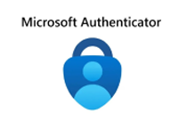
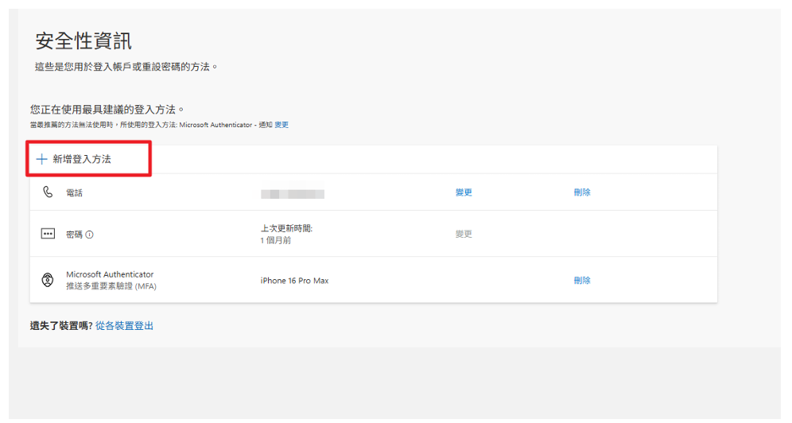
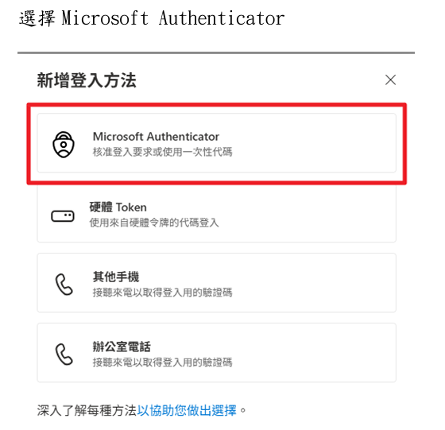
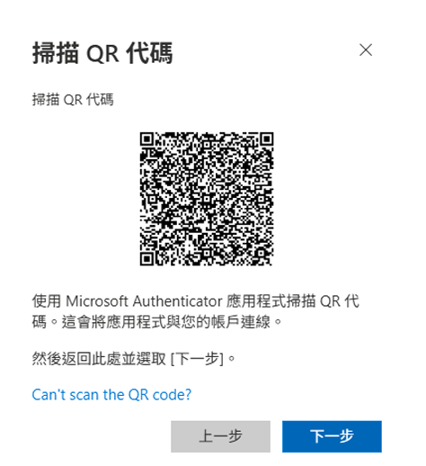
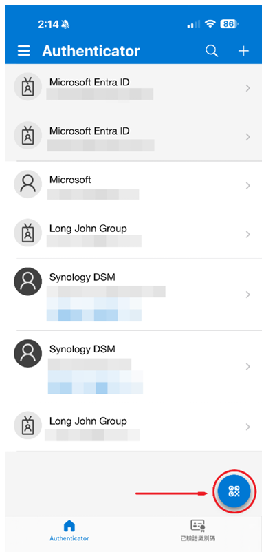

## 1. Purpose 目的

協助用戶能獨立完成多因子驗證器轉換手機綁定步驟，確保用戶可以順利登入帳號。

## 2. Authenticator Setting 多因子換機設定

換機前的重要提醒：

在這份指南完成前，請絕對不要刪除舊手機上的  或清除舊手機資料。

（如果您的舊手機已經壞了、遺失或格式化，請跳過此手冊，直接聯絡 IT 人員協助重設。）

### 2.1 準備工具

1. 電腦（用來操作設定畫面）
2. 舊手機（用來接收最後一次驗證）
3. 新手機（請先下載好 Microsoft Authenticator）

### 2.2 開始設定

首先打開電腦瀏覽器，網址列輸入 `https://aka.ms/mfasetup`，在登入到此畫面時，先用舊手機使帳號登入，登入之後再點擊新增登入方法。

### 2.3 選擇驗證方式

選擇 Microsoft Authenticator。

### 2.4 掃描 QR code 完成綁定

照著畫面指示一直下一步直到以下 QR code 畫面，拿出新手機按右下角圖示掃描 QR code 添加即可完成綁定。

## 相關概念

- [密碼變更指南](/it-support/password-change-guide.md)
